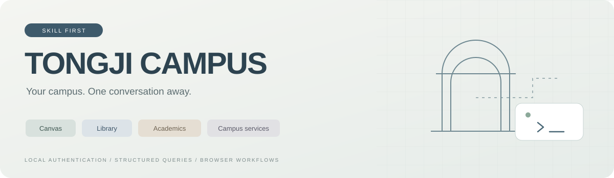

<p align="center">
  
</p>

<h1 align="center">同济校园助手</h1>

<p align="center">用自然语言查作业、找座位、看学业进度，把校园网站变成 AI 助手可以使用的工具。</p>

<p align="center">
  <a href="https://github.com/JERRIYHAN/tongji-cli/releases"></a>
  
  <a href="LICENSE"></a>
  <a href="https://github.com/JERRIYHAN/tongji-cli/actions/workflows/ci.yml"></a>
</p>

<p align="center">
  <a href="#快速开始">快速开始</a> ·
  <a href="#使用案例">使用案例</a> ·
  <a href="#可以做什么">功能范围</a> ·
  <a href="#登录与隐私">登录与隐私</a> ·
  <a href="CONTRIBUTING.md">参与完善</a>
</p>

> 同济学生制作的非官方项目，与学校官方系统无隶属关系。使用者通过自己的学校账号访问本人有权限使用的服务。

## 这是什么

这是一个以 **Skill 为主要分发方式**的同济校园助手。Skill 是 AI 助手按任务读取的操作说明，告诉它去哪个校园网站、怎样查询、如何理解结果；项目同时附带一个小型命令行程序，处理认证和常用的结构化查询。

安装后，你可以直接对本地 AI 助手说：

```text
帮我看看未来七天有哪些 Canvas 作业，分别有什么要求。
嘉定图书馆六楼现在有多少空位？
明天下午找一间适合三个人讨论的研习室。
我的培养计划还缺哪些类别的学分？
帮我查看社会实践课的完成情况。
找到官方英文成绩单的下载入口。
```

常用查询由脚本直接完成；需要进一步查看网页的任务，由助手参考已有导航，在官方页面继续操作。**学校认证在你的电脑完成，脚本直接访问学校服务**，项目不运行开发者中转服务器，也不要求另配 AI 服务密钥。

## 快速开始

### 1. 准备环境

- **Node.js 22 或更高版本**，包含 npm。
- 已安装 **Google Chrome 或 Microsoft Edge**。
- 一个能够使用本地文件、执行命令并操作浏览器的 AI 助手。下面提供 Codex 安装方式；其他支持 Skill 的助手也可手动安装。

浏览器自动化依赖使用 `playwright-core`，复用已安装的浏览器，不额外下载 Chromium。

### 2. 安装 Skill

**方式 A：从仓库安装到 Codex**

```bash
git clone https://github.com/JERRIYHAN/tongji-cli.git
cd tongji-cli
npm run install:skill
```

安装程序会复制 Skill 并安装所需依赖。默认位置为 `~/.codex/skills/tongji-campus`；设置了 `CODEX_HOME` 时使用对应目录。已有同名 Skill 时会保留原目录，请先备份再决定如何更新。

重新打开会话或刷新技能列表后，对助手说：

```text
使用 $tongji-campus，帮我查看未来七天截止的作业。
```

**方式 B：下载轻量分发包**

从 [Releases](https://github.com/JERRIYHAN/tongji-cli/releases/latest) 下载 `tongji-campus-版本号.zip`，解压后将 `tongji-campus` 文件夹放进所用助手的 Skill 目录。在该文件夹运行：

```bash
npm ci --ignore-scripts
node scripts/run.mjs doctor
```

不同助手的技能目录和浏览器工具不同，按其安装方式加载 [SKILL.md](skills/tongji-campus/SKILL.md) 即可。使用纯云端聊天时，需要另外提供能访问你本机的执行环境。

### 3. 完成第一次认证

通常直接让助手发起查询即可。它发现需要登录后，会打开学校认证页面，由你扫码；账号密码入口也保留，密码直接填写在学校页面。

需要手动登录时，在 Skill 文件夹运行：

```bash
# Canvas 是默认服务
node scripts/run.mjs auth login

# 图书馆个人借阅、本科教务分别建立业务会话
node scripts/run.mjs auth login --service library
node scripts/run.mjs auth login --service education
```

已有统一认证时，其他服务可能自动通过。目标服务的会话有效时返回 `reused: true`，无需再次打开浏览器；后续直接查询即可。

空间预约、电子文件、一网通办和体育场馆沿各自官网的认证流程进入。学校页面要求本人操作时再扫码，保持同一次任务的浏览器上下文连续使用。

## 可以做什么

项目采用两种互补方式：**脚本查询**返回固定格式的数据，适合反复使用；**浏览器流程**保存网站位置、参数和操作经验，供 Agent 按具体任务继续探索。

| 场景 | 已有脚本查询 | 浏览器流程与导航 |
| --- | --- | --- |
| Canvas | 课程列表、作业摘要、未来截止项 | 作业要求、单元、课件、公告、页面和评分入口 |
| 图书馆馆藏 | 关键词检索、书目与单册状态、本人借阅 | 对照官网查看相关资源 |
| 图书馆空间 | — | 普通座位、研修座位、考研座位，单人／多人研习室的查询与预约流程 |
| 本科教务 | 本人学期课表，按教学周／星期筛选 | 培养计划、学分完成情况、成绩、社会实践及完整菜单索引 |
| 官方电子文件 | — | 中英文成绩单、在读证明等目录及获取流程 |
| 一网通办 | — | 搜索校园事项、定位办事指南与目标系统 |
| 体育场馆 | — | 校区与运动分类、场馆目录、预约时段和订单流程 |

座位、研习室和场馆的实际名额与资格由官网决定。用户只问“有什么”“能不能约”时先查询；用户明确要求办理且条件齐全时，再通过官网提交。

## 使用案例

以下截图由作者提供，展示历史任务中的交互与输出。图中课程、日期、学分、成绩及预约结果是案例内容，当前信息应重新查询；图像不随 Skill 安装包分发。

### 01 · 把 Canvas 作业整理成待办

一句话查看近期截止时间和提交状态，再继续读取作业正文中的必做项、选做项和文件格式。

<p align="center"></p>

<details>
<summary><b>展开：继续询问作业要求</b></summary>

<p align="center"></p>

</details>

### 02 · 从位置偏好走到图书馆预约结果

先查询空位，再结合“四人桌中的一个座位”“靠中间”“到闭馆”等需求选择。普通座位、研修／考研座位和研习室分别使用对应规则。

<table>
<tr>
<td width="48%" valign="top">

**可以这样说**

“帮我看一下嘉定校区图书馆六楼有多少空位。”

“可以帮我预约一个吗？最好是四人桌中的位子，到闭馆。”

助手会核对区域、当日时段和选中编号，完成后报告官网返回的实际预约结果。

</td>
<td width="52%" align="center"></td>
</tr>
</table>

<details>
<summary><b>展开：官网选座界面</b></summary>

<p align="center"></p>

</details>

### 03 · 把课程表变成一周总览

先从教务读取课程和上课安排，再让 Agent 使用绘图工具整理成你喜欢的样式。图中的排版与配图属于案例呈现，课表脚本负责提供结构化数据。

<p align="center"></p>

### 04 · 看懂培养计划的学分缺口

把学校页面按课程类别列出的要求、完成值和差额整理出来，区分“总学分够不够”和“各类别是否达标”。

<details>
<summary><b>展开：学分完成情况分析，以及教务原页面对照</b></summary>

<p align="center"></p>
<p align="center"></p>

</details>

### 05 · 解释社会实践的认定学时

分别查看理论学习、必修实践、选修实践和最终成绩；遇到板块认定上限时，解释实际学时为什么与计入学时不同。

<details>
<summary><b>展开：完成情况分析，以及学校记录对照</b></summary>

<p align="center"></p>
<p align="center"></p>

</details>

### 06 · 按课程名称查询成绩

通过教务成绩页面查找目标课程，回答等级、绩点、学分和所属学期。

<details>
<summary><b>展开：课程成绩查询示例</b></summary>

<p align="center"></p>

</details>

## 想直接运行命令？

不必全局安装独立命令。在仓库中的 `skills/tongji-campus` 文件夹运行：

```bash
npm ci --ignore-scripts
node scripts/run.mjs doctor
node scripts/run.mjs help

# Canvas
node scripts/run.mjs canvas courses
node scripts/run.mjs canvas upcoming --days 7

# 图书馆公开检索，不需要登录
node scripts/run.mjs library search --query "机器学习"

# 本人借阅与本科课表，需要相应服务会话
node scripts/run.mjs library loans
node scripts/run.mjs education timetable
node scripts/run.mjs education timetable --week 3 --weekday 1
```

指定课程或书目时，从上一条查询结果中取得真实 ID：

```bash
node scripts/run.mjs canvas assignments --course <课程ID>
node scripts/run.mjs library item --id <书目ID>
```

尖括号内容是待替换参数，运行时换成实际编号。命令结果采用 JSON，便于其他程序或 Agent 使用：

```json
{ "ok": true, "data": {} }
```

失败时返回 `ok: false` 及错误代码、原因和下一步提示。详细参数见 `help` 和 [Skill 入口](skills/tongji-campus/SKILL.md)。

几个影响结果解释的规则：

- `canvas upcoming --days 7` 从查询时刻起算未来 7×24 小时，包含已提交项；无截止日期作业另计 `undatedCount`。
- 作业摘要不含要求全文；询问要求时，助手继续读取该作业正文及相关附件。
- 图书馆检索默认第一页 10 条，可用 `--page`、`--limit` 翻页；实时可借状态看单册详情。
- 课表 `--week` 是学校教学周，`--weekday 1` 是周一。教学节次与钟点分开处理，日期对应关系来自校历。

## 登录与隐私

一次查询的基本过程是：

```text
你的自然语言请求
        ↓
AI 助手读取相关 Skill 说明
        ↓
本机脚本或浏览器 → 同济官方服务
        ↓
任务所需的查询结果 → AI 整理回答
```

**学校登录凭据保存在本机；查询结果会进入你所用 AI 服务的上下文。** 例如查作业时，课程名和截止时间需要交给模型处理，Cookie 则由本地程序使用。

- 登录使用隔离的浏览器上下文，由本人在学校页面扫码或输入密码，不读取日常 Chrome 的个人配置。
- 已接入脚本只保存允许的学校认证信息。不同服务使用各自凭据；其他网站通过正常统一认证链恢复会话。
- 会话使用用户私有文件权限，以普通 JSON 保存，当前未接入系统钥匙串；同一系统用户下的其他进程仍可能读取它。
- `auth logout` 清除本机保存的副本；学校服务器或其他设备上的会话由学校自己的会话管理控制。
- 提交问题或贡献代码时，只提供复现所需信息，移除账号、凭据、私人订单、个人查询结果和原始网络日志。

默认会话目录由系统选择：

| 系统 | 默认目录 |
| --- | --- |
| macOS | `~/Library/Application Support/tongji-campus/` |
| Windows | `%LOCALAPPDATA%/tongji-campus/` |
| Linux | `$XDG_DATA_HOME/tongji-campus/`，未设置时使用 `~/.local/share/tongji-campus/` |

需要自定义时，将 `TONGJI_CAMPUS_HOME` 设为你自己的私有目录绝对路径。助手和手动终端使用相同设置，才能复用同一份会话。

## 常见问题

**为什么做成 Skill，还保留脚本？**

脚本让课程、作业、借阅等重复查询有固定参数和输出；Skill 保存菜单、规则和浏览器经验，让助手处理尚未封装成命令的任务。新增校园服务时，可以先完善网页流程，再将高频操作写成适配器。

**每次都要扫码吗？**

有效会话直接复用。各网站业务会话与统一认证会话可能分别到期，需要认证时才恢复；网络或权限错误按实际原因排查。

**浏览器打不开怎么办？**

先运行 `doctor`，确认 Chrome／Edge 和依赖可用，再查看宿主是否允许启动浏览器。如果当前助手不能启动本机窗口，可以由用户终端完成登录；已有有效会话的脚本查询不需要浏览器。

**能预约、下载文件或办理业务吗？**

对应子文档记录了官网流程，Agent 可以按用户明确需求继续办理。页面名额、资格、表单及费用需要当次核对；查询目录本身不产生下单授权。

**网站更新了怎么办？**

欢迎让 Agent 查看当前页面、请求及相关前端函数，修正入口和参数，再将通用流程贡献回来。仓库更适合作为持续完善的校园知识与工具集合。

## 文档与贡献

| 资料 | 内容 |
| --- | --- |
| [Skill 入口](skills/tongji-campus/SKILL.md) | 任务路由、命令、认证和探索方法 |
| [Canvas](skills/tongji-campus/references/canvas-navigation.md) | 全局菜单、课程栏目及扩展读取 |
| [座位](skills/tongji-campus/references/library-seats.md) · [研习室](skills/tongji-campus/references/library-study-rooms.md) | 两类空间的查询、规则和预约链路 |
| [本科教务](skills/tongji-campus/references/education-navigation.md) | 培养、选课、考试、成绩等菜单索引 |
| [官方电子文件](skills/tongji-campus/references/official-documents.md) | 文件目录和获取方式 |
| [一网通办](skills/tongji-campus/references/service-hall.md) | 校园办事入口与服务目录 |
| [体育场馆](skills/tongji-campus/references/stadium.md) | 场馆、时段、规则和订单流程 |
| [贡献指南](CONTRIBUTING.md) | 探索新网站、反馈问题、提交改进 |

开发与验证：

```bash
npm test
npm run check
npm run build
```

测试使用人工数据，不连接个人账号；检查验证分发文件、脚本语法、依赖锁定和命令入口。构建结果位于 `dist/`，供 Release 分发。

项目结构：

```text
tongji-cli/
├── skills/tongji-campus/    # 可安装的 Skill：说明、脚本、参考资料
├── tools/                  # 安装、检查与打包工具
├── tests/                  # 离线测试
├── assets/readme/          # 项目封面和案例截图
└── .github/workflows/       # 自动验证
```

## 致谢与许可

项目的校园工具思路及说明组织参考了 [AwesomeHou/szu-cli](https://github.com/AwesomeHou/szu-cli)；同济认证流程参考了 [mmmlllnnn/TongJi_Canvas](https://github.com/mmmlllnnn/TongJi_Canvas)。感谢这些项目提供的启发。本仓库代码独立编写，采用 [MIT License](LICENSE)。
