<p align="center">
  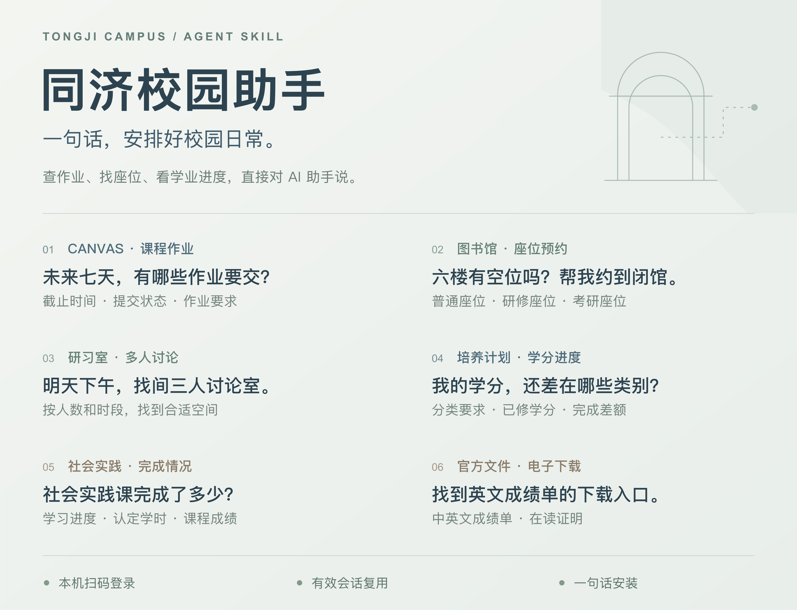
</p>

<p align="center">
  <a href="https://github.com/JERRIYHAN/tongji-online/releases"></a>
  
  <a href="LICENSE"></a>
  <a href="https://github.com/JERRIYHAN/tongji-online/actions/workflows/ci.yml"></a>
</p>

<p align="center">
  <a href="#快速开始">快速开始</a> ·
  <a href="#使用案例">使用案例</a> ·
  <a href="#可以做什么">功能范围</a> ·
  <a href="#登录与隐私">登录与隐私</a> ·
  <a href="CONTRIBUTING.md">参与完善</a>
</p>

> 同济学生制作的非官方校园工具。

## 这是什么

给 AI 助手装上 **tongji-online 技能包**，把校园网站的入口和操作方法交给它，你直接说需求。常用查询由本地脚本完成，更多功能由 Agent 沿着网站导航继续探索。

## 快速开始

### 📦 安装 Skill

**方式 A：给 Agent 一句话，交给它安装**

复制下面这句话，发送给你使用的 AI 助手：

```text
请从 https://github.com/JERRIYHAN/tongji-online/tree/main/skills/tongji-online 下载并安装 tongji-online 技能到你使用的 Skill 目录，安装所需依赖并运行环境检查。
```

**方式 B：从仓库安装到 Codex**

```bash
git clone https://github.com/JERRIYHAN/tongji-online.git
cd tongji-online
npm run install:skill
```

安装程序会自动复制技能并安装依赖，默认安装到 `~/.codex/skills/tongji-online`，也支持通过 `CODEX_HOME` 指定位置。

<details>
<summary>📥 也可以下载 ZIP 安装</summary>

从 [Releases](https://github.com/JERRIYHAN/tongji-online/releases/latest) 下载 `tongji-online-版本号.zip`，解压后将 `tongji-online` 文件夹放进助手的 Skill 目录，在该文件夹运行：

```bash
npm ci --ignore-scripts
node scripts/run.mjs doctor
```

</details>

### 💬 开始使用

重新打开会话或刷新技能列表，然后直接提问：

```text
使用 tongji-online，帮我查看未来七天截止的作业。
```

首次使用时，助手会打开同济统一认证页面，请在页面扫码。之后自动复用有效登录态。

**运行环境**：Node.js 22+（含 npm）、Google Chrome 或 Microsoft Edge，以及能读取本地技能、执行命令和操作浏览器的 AI 助手。浏览器自动化复用已安装的 Chrome／Edge，无需另装浏览器。

### 👨🏻‍🔧 关于登录验证

登录态保存在本机，不上传至 AI 服务。推荐优先使用扫码登录，并在学校支持时启用双重身份验证（2FA），无需向 AI 助手提供密码。

## 可以做什么

从课程学习到校园生活，常用查询有现成脚本，网页操作有完整导航，助手可以按你的需求接着完成任务。

| 场景 | 可以让助手做什么 |
| --- | --- |
| 📚 Canvas | 查课程与近期作业，读懂作业要求，查阅课件、公告和评分信息 |
| 📖 图书馆馆藏 | 搜书、查看单册状态、查询本人借阅 |
| 🪑 图书馆空间 | 查询与预约普通座位、研修座位、考研座位，以及单人／多人研习室 |
| 🎓 本科教务 | 看课表、查成绩、分析培养计划与学分缺口、核对社会实践完成情况 |
| 📄 官方电子文件 | 找到中英文成绩单、在读证明等文件及获取入口 |
| 🏫 一网通办 | 搜索校园事项，定位办事指南和目标系统 |
| 🪪 一卡通 | 查询校园卡余额与消费流水，定位宿舍缴费、挂失／解挂和查询密码修改入口 |
| 🏸 体育场馆 | 按校区和运动查找场馆，查询预约时段、办理预约及查看订单 |

🪪 也可以直接说：“帮我查一下校园卡余额，再看看这个月的消费流水。”

## 使用案例

看看实际使用中，一句话能带来怎样的结果。

### 📚 把 Canvas 作业整理成待办

一句话查看近期截止时间和提交状态，再继续读取作业正文中的必做项、选做项和文件格式。

<p align="center">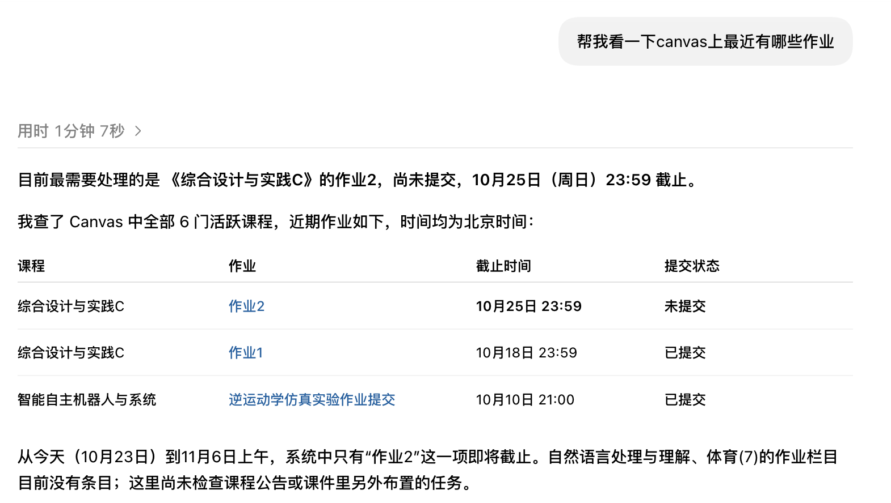</p>

<details>
<summary><b>展开：继续询问作业要求</b></summary>

<p align="center">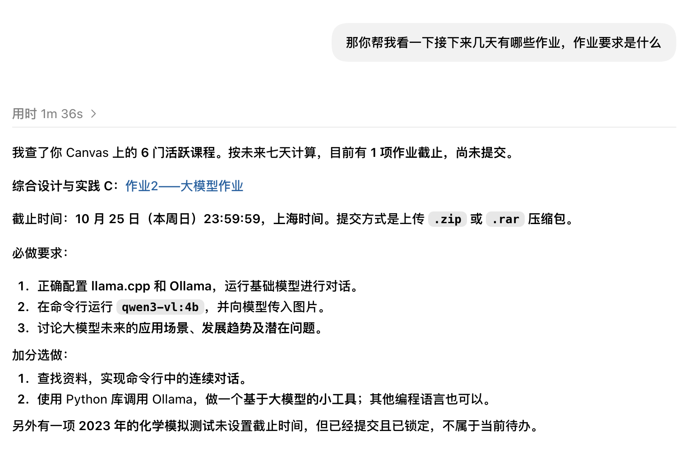</p>

</details>

### 🪑 按偏好预约图书馆座位

告诉助手你想坐哪里、用到几点，它会查询空位，按你的偏好选择并预约。

<table>
<tr>
<td width="48%" valign="top">

**可以这样说**

“帮我看一下嘉定校区图书馆六楼有多少空位。”

“可以帮我预约一个吗？最好是四人桌中的位子，到闭馆。”

从查空位到预约成功，在同一段对话里完成。

</td>
<td width="52%" align="center">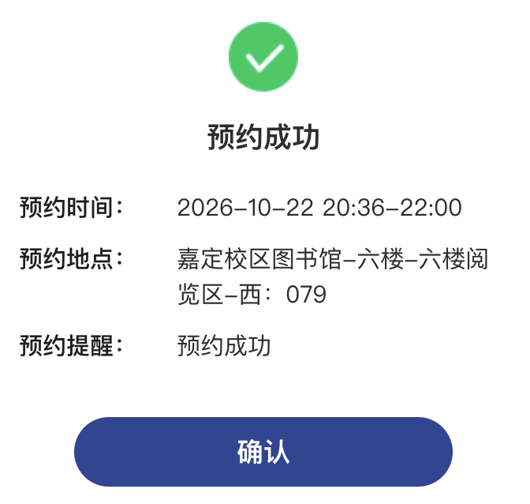</td>
</tr>
</table>

<details>
<summary><b>展开：官网选座界面</b></summary>

<p align="center">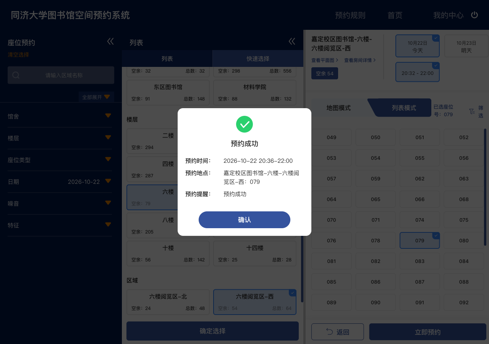</p>

</details>

### 🗓️ 把课程表变成一周总览

从教务读取上课安排，让 Agent 整理成清晰的一周课表。配色、排版和风格都可以直接告诉它。

<p align="center">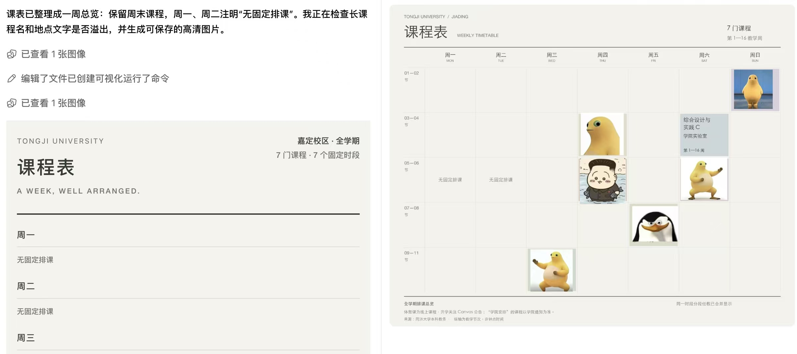</p>

### 🎓 看懂培养计划的学分缺口

把学校页面按课程类别列出的要求、完成值和差额整理出来，区分“总学分够不够”和“各类别是否达标”。

<details>
<summary><b>展开：学分完成情况分析，以及教务原页面对照</b></summary>

<p align="center">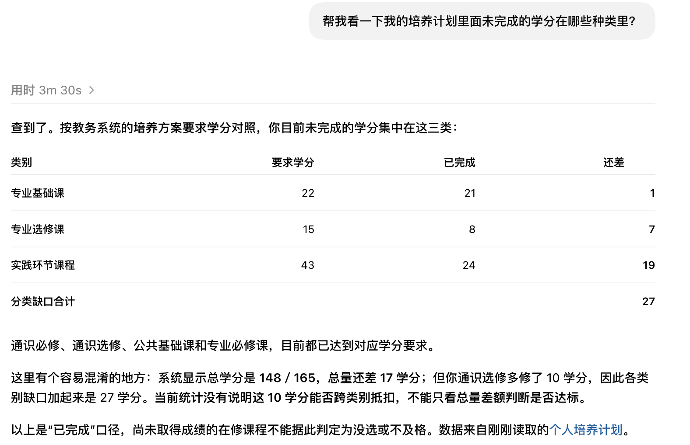</p>
<p align="center">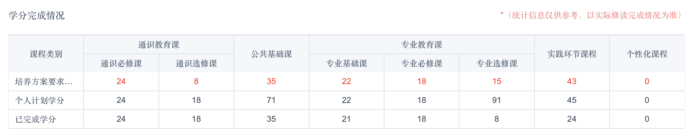</p>

</details>

### ✅ 看清社会实践的完成进度

分别查看理论学习、必修实践、选修实践和最终成绩；遇到板块认定上限时，解释实际学时为什么与计入学时不同。

<details>
<summary><b>展开：完成情况分析，以及学校记录对照</b></summary>

<p align="center">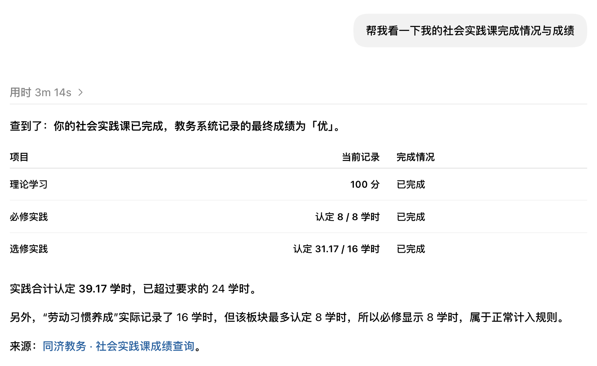</p>
<p align="center">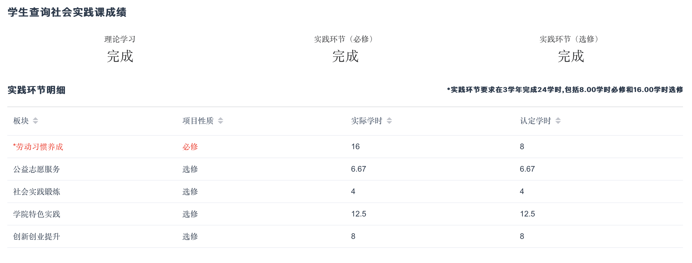</p>

</details>

### 🔎 按课程名称查询成绩

通过教务成绩页面查找目标课程，回答等级、绩点、学分和所属学期。

<details>
<summary><b>展开：课程成绩查询示例</b></summary>

<p align="center">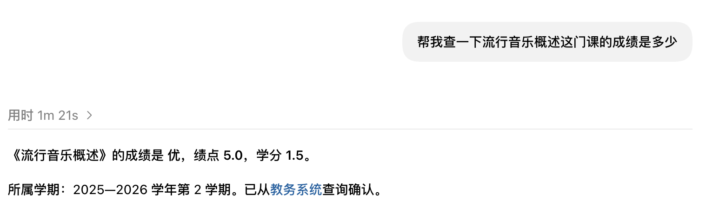</p>

</details>

### 🪪 一句话查询一卡通余额

直接问“我的一卡通还剩多少钱”，助手复用登录态，从官网读取当前账户余额。

<p align="center">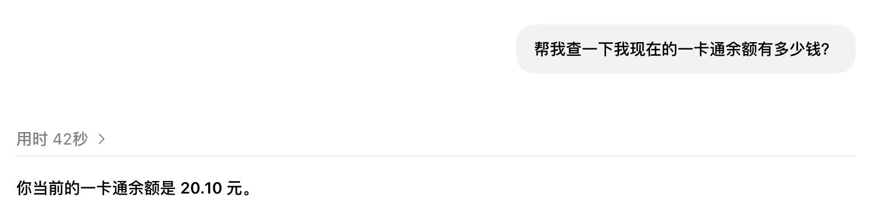</p>

### 🧾 看懂半年消费都花在哪里

指定时间范围，按消费地点汇总金额、笔数和占比，再看每个月的变化。充值与实际消费分开统计，让流水变成一份清晰的消费总结。

<p align="center">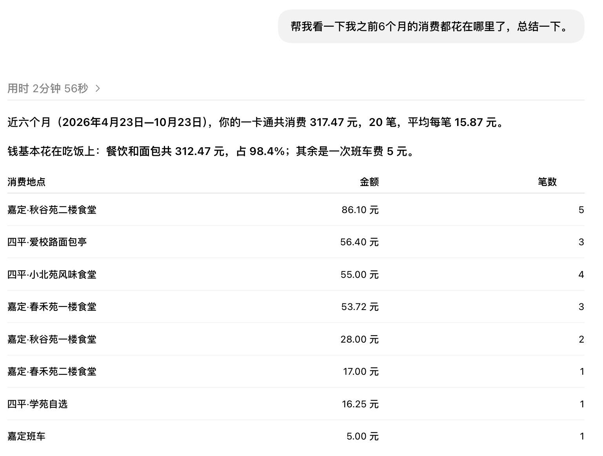</p>

## 登录与隐私

- 🔐 **认证在本机完成**：由本地程序直接访问学校服务，学校登录凭据保存在你的电脑上，无需开发者中转服务器。
- 🧠 **用你选择的 AI 整理结果**：课程、作业、成绩等查询内容会交给你使用的 AI 服务处理；Cookie 由本地程序使用。
- 💻 **会话本地管理**：以用户私有文件权限保存为 JSON 文件，使用 `auth logout` 清除本地保存的会话。

<details>
<summary>查看会话保存位置</summary>

| 系统 | 默认目录 |
| --- | --- |
| macOS | `~/Library/Application Support/tongji-online/` |
| Windows | `%LOCALAPPDATA%/tongji-online/` |
| Linux | `$XDG_DATA_HOME/tongji-online/`，未设置时使用 `~/.local/share/tongji-online/` |

通过 `TONGJI_ONLINE_HOME` 可以指定私有目录；助手和终端使用相同设置即可共享登录态。旧版升级会沿用已有会话目录，并兼容原配置变量。

</details>

## 命令用法

<details>
<summary>⌨️ 展开常用命令</summary>

在 Skill 文件夹运行：

```bash
# 检查环境与查看帮助
node scripts/run.mjs doctor
node scripts/run.mjs help

# Canvas 课程与未来七天作业
node scripts/run.mjs canvas courses
node scripts/run.mjs canvas upcoming --days 7

# 图书馆检索与本人借阅
node scripts/run.mjs library search --query "机器学习"
node scripts/run.mjs library loans

# 本科课表，支持按教学周和星期筛选
node scripts/run.mjs education timetable
node scripts/run.mjs education timetable --week 3 --weekday 1

# 手动发起各服务登录
node scripts/run.mjs auth login
node scripts/run.mjs auth login --service library
node scripts/run.mjs auth login --service education
```

命令返回 JSON 格式数据，方便 Agent 和其他程序继续处理。完整参数与结果说明见 `help` 和 [Skill 入口](skills/tongji-online/SKILL.md)。

</details>

## 文档与贡献

🌱 欢迎让你的 Agent 探索更多校园功能，把新入口和操作流程补充到 Skill 中，让下一个使用者直接受益。参与方式见 [贡献指南](CONTRIBUTING.md)。

| 资料 | 内容 |
| --- | --- |
| [Skill 入口](skills/tongji-online/SKILL.md) | 任务路由、命令、认证和探索方法 |
| [Canvas](skills/tongji-online/references/canvas-navigation.md) | 全局菜单、课程栏目及扩展读取 |
| [座位](skills/tongji-online/references/library-seats.md) · [研习室](skills/tongji-online/references/library-study-rooms.md) | 两类空间的查询、规则和预约链路 |
| [本科教务](skills/tongji-online/references/education-navigation.md) | 培养、选课、考试、成绩等菜单索引 |
| [官方电子文件](skills/tongji-online/references/official-documents.md) | 文件目录和获取方式 |
| [一网通办](skills/tongji-online/references/service-hall.md) | 校园办事入口与服务目录 |
| [一卡通](skills/tongji-online/references/campus-card.md) | 服务中心七项功能、余额与流水查询、宿舍缴费入口 |
| [体育场馆](skills/tongji-online/references/stadium.md) | 场馆、时段、规则和订单流程 |
| [贡献指南](CONTRIBUTING.md) | 探索新网站、反馈问题、提交改进 |

<details>
<summary>🛠️ 开发与构建</summary>

```bash
npm test
npm run check
npm run build
```

构建产物位于 `dist/`，可用于分发技能包。

</details>

## 开源协议说明

本项目采用 [MIT License](LICENSE)，欢迎使用、修改和分发。分发时请保留原版权声明与许可证。
